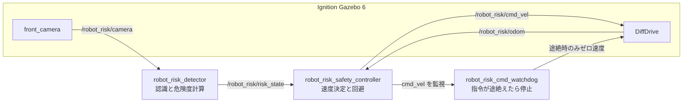

# ROS 2 ロボット危険度推定・回避システム

ROS 2 Humble と Ignition Gazebo 6 を使ったシミュレーションのシステムです。ロボット搭載カメラの画像から障害物と人を認識し、危険度を0〜100で数値化します。その結果に応じて、減速、停止、障害物の回避、人の通過待ちを行います。

最終実験では、障害物3個と横切る人を配置したスラローム環境で、目標地点への到達を確認しました。

## 提出リポジトリ

https://github.com/knaustry/robot-risk-detection

## 提出動画

| 項目 | 内容 |
|---|---|
| ファイル名 | `ros2 camera diag.mp4`（1分04秒、1280×720、H.264） |
| 内容 | 最終実験（ラン `slalom_final5`）の録画。文字カードなし、シミュレーション時間と等倍 |
| YouTube URL | https://youtu.be/BOf0Lz1CN_0 |

動画ファイルはこのリポジトリに含めていません。

## システム構成



Gazebo と ROS 2 の間は `ros_gz_bridge` でつなぎます。Gazeboの真値の姿勢は、ログと評価だけに使います。検知と制御には入力していません。

より詳しい構成図は [report_materials/system_architecture.md](report_materials/system_architecture.md) にあります。

### 主なファイル

| 役割 | ファイル |
|---|---|
| 最終ワールド | `robot_risk_office_slalom.sdf`、`risk_system/scene_slalom.json` |
| ワールドの生成 | `risk_system/make_office_world.py`、`risk_system/make_office_slalom_world.py`（生成元：`robot_risk_world.sdf`、`robot_risk_office.sdf`） |
| 認識と危険度 | `risk_system/risk_core.py`、`risk_system/robot_risk_detector.py` |
| 制御 | `risk_system/robot_risk_safety_controller.py`、`risk_system/robot_risk_cmd_watchdog.py` |
| シナリオ（人の移動） | `risk_system/demo_walk_scenario.py`、`risk_system/pose_client.cpp` |
| 記録 | `risk_system/run_logger.py`、`risk_system/robot_risk_recorder.py` |
| 起動 | `run_pai_container.sh`、`risk_system/common.sh`、`start_sim.sh`、`run_slalom.sh`、`stop_all.sh`、`status.sh` |

## 使用技術と実行環境

確認した環境は次のとおりです。

| 項目 | 内容 |
|---|---|
| ホスト | macOS 27.0.1（arm64）、Docker 29.7.2 |
| コンテナイメージ | `airobotbook/ros2-desktop-ai-robot-book-humble:latest`（`sha256:0380d72bdbae44bf1714ccf6f725b7409e336f36ac27af7a7425864acbd8ccc0`、linux/amd64） |
| OS | Ubuntu 22.04.5（コンテナ内） |
| ミドルウェア | ROS 2 Humble（rclpy 3.3.15、ros_gz_bridge 0.244.16） |
| シミュレータ | Ignition Gazebo 6.16.0（ogre2、ヘッドレス） |
| 言語・ライブラリ | Python 3.10.12、OpenCV 4.5.4、NumPy 1.24.4、Pillow 9.0.1、C++（`pose_client`） |
| 動画の変換 | ffmpeg 4.4.2（libx264） |

開発に使ったコンテナには、イメージの配布後に `xvfb libgl1-mesa-dri libegl1` を追加していました。新しいコンテナで必要かどうかは未確認です（[CLONE_VERIFICATION.md](CLONE_VERIFICATION.md)）。

## 危険度の推定方法

処理の本体は `risk_system/risk_core.py` です。物体の色は使いません。

1. **床の境界：** 画像の列ごとに下から走査し、色の不連続または床の色からの外れを探します。
2. **推定距離：** 平坦な床を仮定し、境界の行を距離に換算します（カメラ高さ0.67 m、下向き0.10 rad）。これは測距ではなく推定です。
3. **物体化：** 距離の近い列をまとめ、幅、高さ、左右端の位置を求めます。
4. **人の判定：** 高さ1.15〜2.1 m、縦長、接地部が細い、独立して立っている、という形状のルールです。学習済みモデルではありません。
5. **危険度：**

```text
risk = 100 × 接近度 × (0.3 + 0.7 × 進路係数) × (0.7 + 0.3 × 信頼度)
```

| 要素 | 定義 |
|---|---|
| 接近度 | 障害物：3.5 m（0）〜1.4 m（1）。人：4.5 m（0）〜1.9 m（1） |
| 進路係数 | 通路（±0.40 m）にかかれば1。外れると0.6 mかけて0まで下がる |
| 信頼度 | 境界のコントラストと物体の幅から算出（0〜1） |

接近度と進路係数がともに1の時は100です。スコアは調整で決めた相対値で、衝突確率ではありません。

## 制御と回避の方法

速度は最終実験の設定値です（`run_slalom.sh` の既定値）。

| 状態 | 条件 | 動作 |
|---|---|---|
| CLEAR / OBSTACLE_FAR | 検出なし / リスク < 30 | 0.30 m/sで前進 |
| APPROACHING | リスク30以上など | リスクに応じて減速（下限0.15 m/s） |
| PERSON | 通路内で4.5 m未満、または3 m未満に人 | 0.12 m/sで徐行（1.0 m以上横の人では徐行しない） |
| STOP | リスク ≥ 70（60未満で解除）、進路上または1.25 m未満 | 停止。障害物なら迂回、人なら待機 |
| INVALID | 画像の欠落、途絶、タイムスタンプ停止、一様な画像など | 停止 |

- **障害物の回避：** カメラで測った端から0.65 m離れた2つの経由点を、オドメトリ座標で計画します。通過中は、経由点までの線分が検出物体から0.45 m以上離れていることを確かめて進みます。迂回した障害物の位置は記憶し、視野の外に出てもそちらへ曲がらないようにします。
- **人の通過待ち：** 進路上の人のリスクが60以上なら停止します。人の周りは迂回しません。近くに物体がなくなって1秒経ったら再開します（上限12秒）。
- **異常時の停止：** カメラの途絶やリスク状態、オドメトリの途絶（いずれも実時間1.5 s）で停止します。コントローラが落ちると、watchdogが0.5秒後にゼロ速度を送ります。

## 実行手順

リポジトリのルートで実行します。スクリプトは、このフォルダがコンテナの `/workspace` に見えることを前提にしています。

**1. コンテナを起動します。** 名前 `pai_ros2`、ポート6080、9090、9876を使います。

```bash
bash run_pai_container.sh
```

**2. `pose_client` をビルドします。** 実行ファイルはリポジトリに含めていません。

```bash
docker exec pai_ros2 bash -c 'cd /workspace/risk_system && g++ -O1 -std=c++17 pose_client.cpp -o pose_client $(pkg-config --cflags --libs ignition-transport11 ignition-msgs8)'
```

**3. 最終ワールドでシミュレーションを起動します。** `WORLD` を付け忘れると旧ワールド（`robot_risk_world.sdf`）が起動するので注意してください。

```bash
docker exec -e WORLD=/workspace/robot_risk_office_slalom.sdf pai_ros2 bash /workspace/risk_system/start_sim.sh
```

**4. 実験を実行します。** `myrun` は任意の名前です。`record` を外すと録画しません。

```bash
docker exec pai_ros2 bash /workspace/risk_system/run_slalom.sh myrun record
```

| 出力 | パス |
|---|---|
| ログ | `risk_system/logs/slalom_myrun.csv` ほか |
| 録画 | `risk_system/videos/raw_slalom_myrun.mp4` |
| 実行記録 | `risk_system/logs/slalom_runs.txt` に追記 |

同じ名前を使うとログは上書きされます。`final5` など既存の名前は使わないでください。

**5. 状態の確認と停止です。**

```bash
docker exec pai_ros2 bash /workspace/risk_system/status.sh
```
```bash
docker exec pai_ros2 bash /workspace/risk_system/stop_all.sh --all
```

個別の測定方法は [report_materials/reproducibility.md](report_materials/reproducibility.md) にあります。

## 最終実験の結果

ラン `slalom_final5` の実測値です（`risk_system/logs/slalom_final5.csv`、`slalom_runs.txt`）。

| 項目 | 値 |
|---|---|
| 目標到達 | はい。終了位置 (5.74, −0.56) m（Gazeboの真値） |
| 走行時間 / 経路長 | 59.2 s / 11.03 m（シミュレーション時間、真値の積算） |
| 最大の速度指令 | 0.30 m/s（走行中の平均0.202 m/s） |
| 最小クリアランス | 0.268 m（ロボット外接円と obstacle_2） |
| 最大ピッチ | 0.78° |
| 流れ | 右へ迂回 → 左へ迂回 → 人を2.9 s待機 → 再開 → 右へ迂回 → 到着 |
| INVALID | 0回 |

| 関連の測定 | 結果 | 根拠 |
|---|---|---|
| 検知の遅れ | 132〜330 ms（シミュレーション時間、6回） | `slalom_speed_metrics.txt` |
| 故障時の停止（0.30 m/s指令） | 検知ノード停止0.152 m、カメラ停止0.137 m、コントローラ停止0.083 m | `slalom_fault_tests.txt` |
| 距離の推定誤差（オフィス） | 障害物 ≤0.21 m、人 ≤0.41 m（スラロームのワールドでは未測定） | `office_detection_sweep.csv` |

調整値と失敗したランの記録は [risk_system/SLALOM_RESULTS.md](risk_system/SLALOM_RESULTS.md)、レポートは [risk_system/REPORT.md](risk_system/REPORT.md)、図表とデータは [report_materials/](report_materials/) にあります。

## 制約と今後の課題

- **検証した配置は1つです。** 配置の調整も成功の要因に含まれます。最終設定そのものでの実行は1回で、比較実験もしていません。
- **調整中の失敗があります。** 途中停止が2回、事実上の接触が1回（クリアランス −0.022 m）ありました。最終版では対策していますが、すべての配置で防げるとは確認していません。
- **人の判定は形状のルールです。** 箱形の人モデルでのみ確認しています。近距離で obstacle に切り替わる場面や、ケースと奥の植物を人と誤判定する場面が残っています。
- **距離は単眼カメラの推定です。** 平坦な床を仮定しています。カメラから約1.2 m以内は死角です。
- **視野は前方60°です。** 視野の外の物体は記憶で避けるだけで、記憶していない物体は避けられません。
- **cmd_velのブリッジが止まると防げません。** DiffDriveは最後の指令を保持します。この故障は試験していません。
- **結果はシミュレーションのものです。** 実機では確認していません。停止距離も理想的な駆動の値です。
- **実時間比は約0.4〜0.5です。** タイムアウトは実時間で判定するので、速いマシンでは停止までの距離が伸びる可能性があります。
- **人の動きはシナリオ上のものです。** `set_pose` で滑らかに動かしており、足を動かす歩行ではありません。

## ライセンス

未設定です。公開の規定を確認してから決定します。
