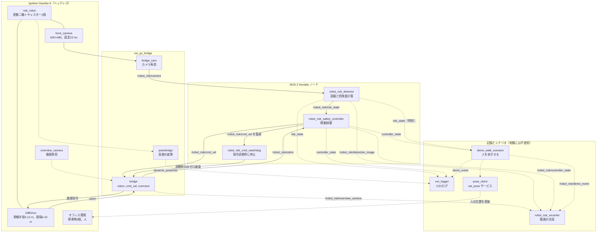
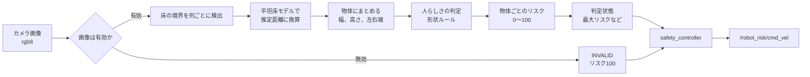
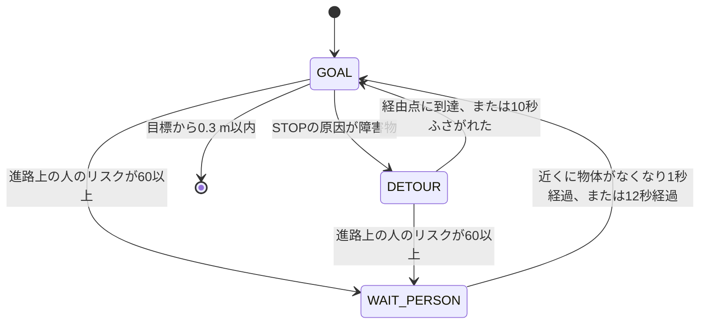

# システム構成

根拠：`risk_system/` のソースコードと `/workspace/robot_risk_office_slalom.sdf`。行番号は2026-10-31時点のものです。

## 図1：全体構成

各ノードは別プロセスです。実線はROS 2トピックまたはGazeboの通信、点線はテストと動画専用で制御には使いません。

## 図2：認識から速度指令までの処理

## 図3：制御モードの遷移

カメラ無効や通信途絶では、モードに関わらず速度をゼロにします（`robot_risk_safety_controller.py` の `tick`、223行〜）。

## 各要素の役割

| 要素 | 役割 | 根拠 |
|---|---|---|
| Gazebo | 物理とカメラ描画。ワールドは `robot_risk_office_slalom.sdf` | `start_sim.sh` |
| ROS 2 | ノード間の通信 | 各ノードのソース |
| カメラ | 水平画角1.05 rad、床から0.67 m、下向き0.10 rad | SDF、`risk_core.py:24-26` |
| 認識処理 | 床境界の検出と推定距離、物体化、人の判定 | `risk_core.py:121`（boundary）、`:145`（process）、`:207`（_top_row）、`:273`（独立判定） |
| 危険度計算 | `100 × 接近度 × (0.3 + 0.7 × 進路係数) × (0.7 + 0.3 × 信頼度)` | `risk_core.py:289` |
| 判定閾値 | 減速30、停止70、解除60 | `risk_core.py:41-43` |
| 移動制御 | 速度決定、迂回、人の待機 | `robot_risk_safety_controller.py:155`（plan_detour）、`:185`（segment_clear）、`:201`（memory_blocks）、`:256`（人の条件） |
| タイムアウト | カメラ1.5 s、リスク状態とオドメトリ1.5 s、指令0.5 s（いずれも実時間） | `robot_risk_detector.py:29`、`robot_risk_safety_controller.py:33-34`、`robot_risk_cmd_watchdog.py:15` |

## 主なトピック

| トピック | 型 | 発行元 → 購読先 |
|---|---|---|
| `/robot_risk/camera` | `sensor_msgs/Image` | bridge_cam → detector |
| `/robot_risk/risk_state` | `std_msgs/String`（JSON） | detector → controller, recorder, logger, scenario |
| `/robot_risk/risk_score` | `std_msgs/Float32` | detector → 購読先なし |
| `/robot_risk/detection_image` | `sensor_msgs/Image` | detector → recorder |
| `/robot_risk/odom` | `nav_msgs/Odometry` | bridge → controller |
| `/robot_risk/cmd_vel` | `geometry_msgs/Twist` | controller, watchdog → bridge |
| `/robot_risk/controller_state` | `std_msgs/String`（JSON） | controller → recorder, logger, scenario |
| `/robot_risk/demo_event` | `std_msgs/String` | scenario → recorder, logger |
| `/world/robot_risk_world/dynamic_pose/info` | `tf2_msgs/TFMessage` | posebridge → logger, テスト |

## 注意点

- 真値の姿勢（`posebridge`）はログと評価だけに使い、検知と制御には入力していません。
- `/robot_risk/cmd_vel` の通常の発行元はコントローラだけです。watchdogは、走行中に指令が0.5秒途絶えた時だけゼロ速度を送ります。
- cmd_velのブリッジ自体が止まると、この構成では止められません（DiffDriveが最後の指令を保持するため）。この故障は試験していません。
